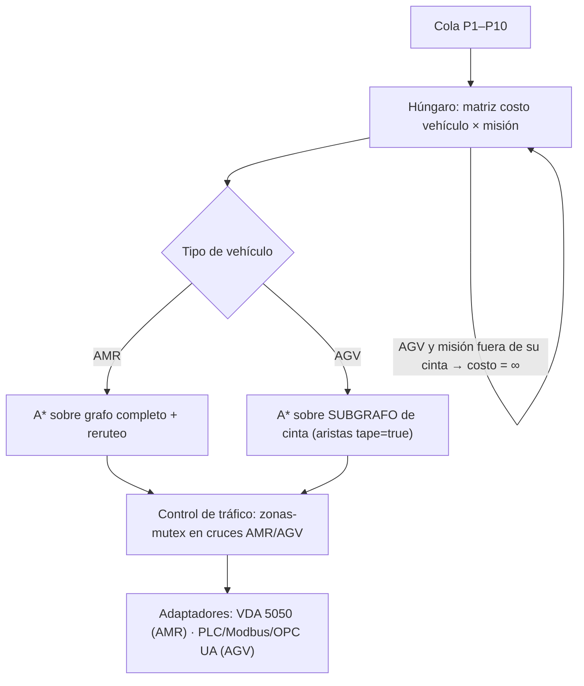

# Investigación · Flota híbrida AGV de cinta magnética + AMR (Fase 2 · Loja)

> **Estado:** investigación, solo documento. No hay código y no se tocó git.
> **Regla de cifras:** los números canónicos del caso **no cambian** (1.035 mov/día · 215/131 pallets por turno · takt 132 s · 6 AMRs 5+1 · 89/89 tests · techo 411 pallets/turno (+91 %) · CAPEX $0,95M · ahorro $0,21M/año · payback 4,5 años (≤3 con 3 turnos) · piloto 2 AMR $0,22M reversible <1 turno).
> Todo lo que aparece aquí sobre AGVs es **⚠️ ESTIMACIÓN**: son rangos de mercado de referencia, no una cotización. Antes de llevar una cifra al deck como dato duro hay que validarla con un proveedor.

---

## 1. Cómo funciona un AGV de cinta magnética

**Principio:** se pega o se embebe en el piso una cinta magnética (polo N/S) de unos 25–50 mm de ancho. Debajo del AGV va un **sensor de guiado magnético** (una barra de sensores Hall) que mide cuánto se ha desviado del centro de la cinta, y un lazo PID corrige la dirección. No tiene mapa ni SLAM: **el camino es la cinta**.

- **Puntos de decisión:** etiquetas RFID o *mag-spots* (marcas magnéticas cortas) en el piso. Le indican al AGV que pare, que tome el desvío izquierdo o derecho en una bifurcación, que cambie de velocidad o que está en una estación de carga o descarga.
- **Seguridad:** escáner láser o bumper frontal. Ante un obstáculo **se detiene y espera**: no puede rodearlo porque físicamente no puede salir de la cinta.
- **Control:** lo más habitual es un PLC a bordo y un despachador simple del fabricante, o señales por Modbus TCP/OPC UA/E/S desde un PLC de planta. Su posición solo se conoce **de forma discreta**, en la última etiqueta RFID leída.

**Tipos relevantes para la planta:**

| Tipo | Qué hace | Encaje en NestHive |
|---|---|---|
| **Transporte (unit-load / roller-top)** | Lleva el pallet encima; algunos modelos tienen rodillos o cinta para transferir a un conveyor fijo | Línea → OUT/expedición cuando hay estación de transferencia a la misma altura |
| **Towing (tractor)** | Remolca carros en "tren" | Abastecimiento de insumos en circuito fijo (milk-run) |
| **Fork / pallet jack** | Toma el pallet del piso con horquillas | Sustituto directo del rol del **AMR_06 en la ruta rosada** hacia el muro de entrega |

**Instalación en piso:** se limpia y prepara la superficie (epoxi o concreto), se pega cinta adhesiva de 1 mm o se embebe en una ranura sellada (más duradera, más cara), y después se colocan las etiquetas RFID en los puntos de decisión. Un circuito típico queda instalado en días, no en semanas.

**¿Y si cambia el layout?** Hay que **levantar la cinta y volver a tenderla**, reubicar las etiquetas y recomisionar las rutas. Eso implica obra en piso, una ventana de parada en la zona afectada y coste por metro otra vez. Es la diferencia de fondo con un AMR, que solo necesita *editar el mapa*: en NestHive un nuevo layout es "otro archivo de layout y su grafo".

---

## 2. Comparativa CAPEX / OPEX: AMR vs AGV de cinta (⚠️ estimación)

| Concepto | AMR (clase MiR1200) | AGV cinta magnética | Nota |
|---|---|---|---|
| Unidad | **US$80–120k** (el caso usa ≈$100k) | **US$25–60k** (transporte/towing en la parte baja; fork en la alta) | Rangos de referencia, a cotizar |
| Infraestructura de guiado | $0 (LiDAR + SLAM) | Cinta **US$10–30/m lineal** + etiquetas RFID | Para 300–600 m de circuito: **≈US$3–18k** |
| Software de flota | MiR Fleet (en el caso: $60k con 7 cargadores) | Despachador del fabricante (básico) **+ capa WCS/tráfico propia** | Ver §3: sin VDA 5050 nativo |
| Velocidad cargado | ~1,5 m/s (spec MiR1200 del caso) | **~0,5–1,0 m/s** típico | Ciclo más largo |
| Obstáculos | Los rodea (reruteo A*) | Se detiene y espera | Más bloqueos |
| Cambio de layout | Editar mapa: horas, $≈0 | Volver a tender la cinta: días y $/m otra vez | OPEX oculto |
| OPEX mantenimiento | Baterías, ruedas y sensores (≈ similar) | Lo mismo **+ reparar cinta desgastada** (montacargas, lavado) | ≈US$3–10k/año extra, estimado |
| Higiene (alimentos) | Sin elementos en piso | Los bordes de la cinta acumulan suciedad → la cinta embebida/sellada lo mitiga | Riesgo HACCP, §4 |

**Referencia canónica del CAPEX base ($0,95M):** 6 × MiR1200 $600k · MiR Fleet + 7 cargadores $60k · acoples, cintas y señalización $95k · integración (25 % del hardware) $160k · capacitación $40k → **≈$955k**.

---

## 3. Integración de la flota híbrida con NestHive

El cerebro **no cambia de algoritmo**: cambia el **modelo de vehículo** dentro del grafo y la matriz de costes.

1. **Grafo con tipos de arista.** Cada arista lleva un atributo `allowed_types = {AMR}` o `{AMR, AGV}`. Las aristas de cinta forman un **subgrafo fijo**. Para un AGV, A* corre solo sobre ese subgrafo (en la práctica es una ruta casi única entre estaciones RFID).
2. **Húngaro con factibilidad.** Para cada par (AGV, misión) cuyo origen o destino no esté sobre su cinta, el costo es **∞**. El algoritmo asigna automáticamente cada misión **al vehículo más apto**: las rutas repetitivas de alto volumen van al AGV y lo variable (abastecimiento, `RELOCATION`, excepciones) al AMR. La prioridad P1–P10 y la home-zone siguen igual.
3. **Fallback AMR (argumento clave).** Si una arista de cinta queda bloqueada (pallet caído, limpieza), el AGV no puede reroutear. NestHive **reasigna la misión a un AMR**, que sí puede rodear el bloqueo. Por eso **la reserva N+1 debe ser un AMR**, nunca un AGV.
4. **Control de tráfico en cruces.** Donde un AMR cruza la cinta se define una **zona-mutex**: solo entra un vehículo a la vez y la reserva la otorga el orquestador. Se extiende el `pick_winner` actual (prioridad → distancia → id) con la regla **"el AGV tiene preferencia sobre su cinta; el AMR cede"**, porque el AGV no puede esquivar.
5. **VDA 5050 no alcanza.** Los AGV de cinta típicos **no hablan VDA 5050**: se controlan por PLC (Modbus TCP, Profinet, OPC UA) o por el despachador del fabricante. Hace falta una **capa WCS/control de tráfico** con un adaptador por marca que traduzca una orden VDA de NestHive a comandos de "ir a estación X" y que convierta las lecturas RFID en estado de la flota. El gemelo digital interpola la posición del AGV entre etiquetas. Los 4 mensajes con SAP EWM **no cambian**: EWM sigue viendo una sola flota.
6. **Esfuerzo estimado de software:** atributo de arista, máscara de factibilidad en el húngaro, zonas-mutex y un adaptador AGV. Es **extensión del motor actual**, no reescritura. ⚠️ Sigue sin implementar y sin tests; no se debe presentar como "ya funciona".

---

## 4. Riesgos honestos

| Riesgo | Impacto | Mitigación |
|---|---|---|
| **Rigidez de ruta** | El AGV no desvía; un bloqueo detiene esa ruta | Fallback a AMR (§3.3); AGVs solo en rutas sin cruces peatonales intensos |
| **Cambios de layout** | Volver a tender la cinta: obra + parada de zona + $/m otra vez | AGV solo en tramos estables (línea → OUT, ruta rosada); lo que cambie, con AMR |
| **Cruces AMR vs AGV** | Esperas y bloqueos mutuos; el AGV no cede | Zonas-mutex en el orquestador + preferencia del AGV en su cinta; minimizar el número de cruces en el diseño |
| **Desgaste de piso y cinta** | Montacargas, transpaletas y lavado despegan la cinta → AGV "perdido" | Cinta embebida/sellada o protector; inspección semanal; presupuesto OPEX |
| **Higiene (planta de alimentos)** | Bordes de cinta = punto de suciedad (HACCP) | Cinta embebida y sellada; no tender cinta en zonas de alto riesgo higiénico |
| **Mantenimiento con dos tecnologías** | Dos proveedores, dos repuestos, dos capacitaciones | Elegir 1 modelo de AGV; contratos de servicio; el WCS unifica la operación |
| **Capacidad** | AGV más lento y con más esperas → techo menor (§5) | Mantener utilización ≤75 % (Sakasegawa); dimensionar con margen |
| **Integración (sin VDA 5050)** | Adaptador por marca; el estado es discreto | Exigir Modbus/OPC UA documentado en la compra; validar en el piloto |

---

## 5. ROI: AMR puro vs híbrido (⚠️ estimación con rangos)

### 5.1 Configuración híbrida propuesta: **2 AMR + 4 AGV** (6 vehículos, igual que el caso)

- **4 AGV** en rutas fijas de alto volumen: 3 para línea → OUT/expedición y **1 AGV fork en la ruta rosada** (el rol del AMR_06, que ya es una ruta exclusiva y fija: es el candidato más natural).
- **2 AMR**: 1 flexible (abastecimiento, relocalización, excepciones) y **1 reserva N+1 flexible**, capaz de cubrir cualquier ruta, incluida una cinta bloqueada.

### 5.2 CAPEX

| Partida | Base AMR puro (canónico) | Híbrido bajo | Híbrido medio | Híbrido alto |
|---|---|---|---|---|
| AMR (MiR1200) | 6 × $100k = $600k | 2 × $100k = $200k | $200k | $200k |
| AGV cinta | — | 4 × $25k = $100k | 4 × $42,5k = $170k | 4 × $60k = $240k |
| Cinta + RFID (300–600 m) | — | $4k | $8k | $12k |
| Software de flota + cargadores | $60k | $30k | $35k | $40k |
| Capa WCS/tráfico + adaptador AGV | — | $40k | $70k | $100k |
| Acoples, cintas y señalización | $95k | $80k | $95k | $95k |
| Integración (25 % del hardware) | $160k | $82k | $101k | $120k |
| Capacitación | $40k | $40k | $40k | $40k |
| **Total** | **≈$0,95M** | **≈$0,58M** | **≈$0,72M** | **≈$0,85M** |
| **Ahorro de CAPEX vs base** | — | −39 % | **−24 %** | −11 % |

### 5.3 Beneficio anual y payback

El beneficio base es **$0,21M/año** (canónico). En el híbrido los FTE liberados se mantienen si la capacidad cubre la demanda, pero se pierde algo de productividad (más esperas y menos flexibilidad) y se suma OPEX de cinta (≈$3–10k/año). **Estimación del beneficio neto: $0,17–0,21M/año** (medio ≈$0,19M).

| Escenario | CAPEX | Beneficio/año | **Payback (1 turno base)** |
|---|---|---|---|
| Base AMR puro (canónico) | $0,95M | $0,21M | **4,5 años** (≤3 con 3 turnos) |
| Híbrido optimista | $0,58M | $0,21M | ≈2,8 años |
| **Híbrido medio** | **$0,72M** | **$0,19M** | **≈3,8 años** |
| Híbrido pesimista | $0,85M | $0,17M | ≈5,0 años |

> Lectura: en el escenario medio, el híbrido **adelanta el payback en unos 0,7 años y libera ~$0,23M de CAPEX**. En el pesimista (AGV fork caro, beneficio recortado) **no mejora** al AMR puro. Con 3 turnos, el payback del híbrido baja en la misma proporción que el base (≈2,5 años en el medio, estimado).

### 5.4 El trade-off: capacidad (techo)

- **Supuesto de escala:** techo canónico 411 pallets/turno con 5 unidades de línea → **≈82 pallets/turno por AMR-equivalente**. Es coherente con el Anexo 1: 4 AMR → 303.
- **Eficacia de un AGV vs un AMR: 0,70–0,85 (⚠️ supuesto).** Sale de menor velocidad (≈0,5–1,0 vs 1,5 m/s, con el tramo de viaje como fracción grande del ciclo de 146–158 s) y de esperas sin evasión.
- **Unidades de línea en el híbrido** (la reserva AMR no cuenta, igual que en el base): 1 AMR + 4 AGV × (0,70–0,85) = **3,8–4,4 equivalentes**.

| | Base (5 AMR línea) | Híbrido 2 AMR + 4 AGV |
|---|---|---|
| Techo pallets/turno | **411 (+91 %)** | **≈312–361 (+45 % a +68 %)** |
| Utilización con demanda 215 (takt 132 s) | ≈52 % (coincide con el 53 % de Sakasegawa) | ≈60–69 % |
| ¿Cumple la regla ≤75 %? | Sí, con amplio margen | Sí, con menos margen |
| ¿Cubre el pico ×1,4 (≈301/turno)? | Sí | Sí, justo (312–361) |

**Conclusión del trade-off:** el híbrido cambia **~25 % menos de CAPEX** por **~12–24 % menos de techo**. La espera por pallet sube respecto a los 13 s del base y hay que **validar en simulación** que se mantiene en ≤30 s p95 (KPI comprometido). La holgura de crecimiento a futuro también se reduce.

---

## 6. Respuesta directa: "¿Funciona con 2 AMRs y más AGVs?"

**Sí, con una condición de diseño: los AGVs llevan las rutas fijas y los AMRs llevan la flexibilidad.**

- **Demanda:** 215 pallets de salida por turno → **takt 132 s**. El dimensionamiento canónico pide **≈3,98 AMR-equivalentes** (2,13 × 1,4 ÷ 0,75).
- **Con 2 AMR + 4 AGV:** 1 AMR de línea + 4 AGV × 0,70–0,85 = **3,8–4,4 eq**. Cubre el requisito en el escenario medio-alto. En el bajo (3,8) se apoya en la **reserva AMR durante el pico**. El techo queda en **≈312–361 pallets/turno**, frente a 411 con AMR puro.
- **Con 2 AMR + 5 AGV:** 4,5–5,25 eq → techo **≈370–430**, casi igual al base. CAPEX ≈ +$30–75k sobre el híbrido de 4 AGV, sigue **por debajo de $0,95M**.
- **Lo que NO funciona:** 2 AMR + AGVs **sin** capa de tráfico unificada, o AGVs en zonas que cambian de layout o con alto tránsito peatonal. Tampoco una reserva N+1 que sea AGV: no puede rescatar otra ruta.
- **Cómo encaja con el piloto:** el piloto canónico (2 AMR, $0,22M, reversible <1 turno) **no cambia**. Puede ampliarse con un **AGV de prueba en la ruta rosada** para medir su eficacia real (el 0,70–0,85 de este documento) **antes** de decidir la mezcla de flota en la fase de escalado.

---

## 7. Listo para la slide

**5 bullets:**
1. **Flota híbrida opcional:** AGV de cinta en rutas fijas + AMR en lo variable, con el mismo cerebro NestHive (cola P1–P10 + húngaro + A*).
2. **El húngaro elige el vehículo más apto:** el AGV solo recibe misiones sobre su cinta; el AMR, todo lo demás.
3. **CAPEX estimado ≈$0,72M (0,58–0,85) vs $0,95M** → payback **≈3,8 años vs 4,5** (estimación, a validar con cotización).
4. **Trade-off honesto:** techo ≈312–361 pallets/turno vs 411, todavía por encima del pico de demanda (takt 132 s).
5. **La reserva N+1 siempre es AMR:** si una cinta se bloquea, NestHive reasigna la misión a un robot que sí puede esquivar.

**3 preguntas probables del jurado:**

- **"¿Por qué no todo AGV, si es más barato?"**
  Porque el AGV no se desvía de la cinta: un pallet caído detiene la ruta, y un cambio de layout obliga a volver a tender cinta en piso. Con algunos AMR conservamos flexibilidad y rescate (reserva N+1), y NestHive asigna a cada uno lo que hace mejor. Todo AGV bajaría más el CAPEX, pero también el techo y la resiliencia.

- **"¿Cómo controlan AGVs que no hablan VDA 5050?"**
  Con una capa WCS/tráfico dentro de NestHive: un adaptador por marca (PLC/Modbus/OPC UA) traduce nuestras órdenes a "ir a estación X" y las lecturas RFID a estado. SAP EWM sigue viendo una sola flota con los mismos 4 mensajes. En los cruces, zonas-mutex: un vehículo a la vez y el AMR cede.

- **"¿La cinta no es un problema de higiene y desgaste en una planta de alimentos?"**
  Sí, es un riesgo real. Por eso la usamos embebida y sellada, solo en tramos estables y fuera de zonas de alto riesgo higiénico, con inspección y OPEX de mantenimiento ya presupuestados. Si la planta no lo acepta, el plan base de 6 AMR sigue intacto.

---

### Supuestos a validar (antes de llevarlo al deck como dato duro)
- Cotización real de AGV (transporte/fork) y de cinta por metro para el layout de Loja.
- Longitud real del circuito de cinta (se supusieron 300–600 m).
- Eficacia AGV/AMR (0,70–0,85): medirla en el piloto o modelarla en la simulación (velocidad AGV y sin evasión).
- Política de higiene de la planta sobre elementos en el piso.
