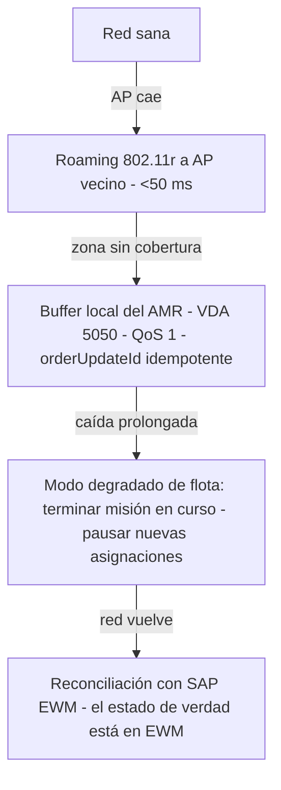

# Capítulo Wi-Fi Industrial + Edge/Failover (Fase 2)

> Material del deck NestLink fase 2 que cierra el chequeo de **Factibilidad (20 %): "integración fluida con SAP/WMS, red Wi-Fi existente"** ([[Bases Fase 2 (Loja)]]). Complementa la capa 5 del deck ([[NestLink · Evolución Fase 2]]: VDA 5050 + SAP EWM).

## 1 · Punto de partida: la red ya existe (y eso es una ventaja)

El caso de negocio de Nestlé lo dice explícitamente: la infraestructura existente incluye **Wi-Fi robusta**, SAP/WMS activo y racks con posición fija.

**Consecuencia de diseño:** no pedimos CAPEX de red — pedimos **usar mejor la red que ya hay**:

| Necesidad de NestLink | Qué exige a la red | Ya cubierto por |
|---|---|---|
| Flota de 6 AMRs en movimiento (1,5 m/s) | Roaming sin cortes entre APs | Red existente + ajustes 802.11k/v/r |
| VDA 5050 (MQTT, QoS 1) | Sesiones persistentes, baja latencia | Red existente |
| 4 mensajes a SAP EWM por pallet | Disponibilidad, no ancho de banda | Red existente + failover edge |

> Mensaje del slide: *"No vendemos red: la usamos."*

## 2 · Diseño de cobertura tipo (a validar en el piloto)

Cifras de ingeniería orientativas para el almacén de racks de 10–12 m ([[Reto 2 Fase 2 · Gestión Inteligente de Inventarios]] tiene el plano):

| Parámetro | Valor tipo | Nota |
|---|---|---|
| Banda primaria | 5 GHz | Menos interferencia; 2,4 GHz solo respaldo |
| RSSI objetivo en pasillo | ≥ −65 dBm en todo el recorrido del AMR | Medición con el AMR como sonda en el mapeo (fase 1 del cronograma) |
| Roaming | **802.11k/v/r** → handover < 50 ms | El AMR nunca pierde la sesión MQTT al cambiar de AP |
| Ancho de canal | 20/40 MHz, plan de canales 1/6/11 alternado | Evita co-canal entre pasillos vecinos |
| Densidad AP | 1 AP por cada 2–3 pasillos, cabeceo hacia el pasillo | Ajustar con *site survey* real |
| Zona refrigerados | APs con rating de temperatura; verificación extra | Caso especial del plano |
| QoS | WMM con prioridad al tráfico de flota | Los mensajes de seguridad/viaje van primero |

**Instrumentación del piloto:** el AMR de mapeo (fase 1 del cronograma de 12 meses) doblega como **sonda de cobertura**: recorre pasillos registrando RSSI/pérdida — el mismo dato que alimenta el mapa LiDAR alimenta el mapa de red.

## 3 · Failover en cascada (el argumento anti-"¿y si se cae el Wi-Fi?")

1. **Nivel 1 — Roaming:** el AMR cambia de AP sin perder sesión (802.11k/v/r).
2. **Nivel 2 — Buffer local:** si pierde cobertura dentro de una zona, el AMR **termina su misión actual** con la cola VDA 5050 local; los mensajes se envían al reconectar sin duplicar (idempotencia `orderUpdateId`).
3. **Nivel 3 — Modo degradado:** si la caída supera el umbral, la flota pausa nuevas asignaciones pero **completa lo que está en curso** (nada queda a mitad de pasillo).
4. **Reconciliación:** al volver la red, cada AMR reporta estado; **SAP EWM es la fuente de verdad** — no hay estado oculto en los robots.

## 4 · Los 5 bullets listos para el slide

1. **No pedimos red nueva: usamos la Wi-Fi que Nestlé ya tiene** (Wi-Fi robusta confirmada en el caso de negocio).
2. **Roaming 802.11k/v/r**: el AMR a 1,5 m/s cambia de AP sin perder su sesión MQTT (<50 ms).
3. **Si un punto queda sin cobertura, el AMR termina su misión** con buffer local VDA 5050 e idempotencia `orderUpdateId` — sin duplicar mensajes a EWM.
4. **Caída prolongada = modo degradado**: flota termina lo iniciado y pausa lo nuevo; **SAP EWM es la fuente de verdad** al reconciliar.
5. **El piloto de 2 AMR incluye el mapa de red**: el AMR de mapeo es también la sonda de cobertura (RSSI ≥ −65 dBm objetivo en pasillo).

## 5 · Preguntas del jurado sobre Wi-Fi (respuestas cortas)

| Pregunta | Respuesta |
|---|---|
| ¿Su solución depende de que Nestlé compre infraestructura nueva? | No — la propuesta asume la Wi-Fi existente; solo exige roaming estándar 802.11k/v/r y un site survey en el mapeo inicial. |
| ¿Qué pasa si un AMR se queda sin señal a mitad de pasillo? | Termina su misión con buffer local (VDA 5050, QoS 1, idempotencia) y sincroniza al reconectar — la misión en curso nunca se aborta por red. |
| ¿Cómo garantizan que la red no sea el cuello de botella con 6 AMRs? | El tráfico de flota es liviano (telemetría y 4 mensajes por pallet, no video); con WMM priorizado y 5 GHz, 6 AMRs usan una fracción mínima de la capacidad — y el techo real lo pone el takt, no la red. |

## Enlaces

[[NestLink · Evolución Fase 2]] · [[Contrato API]] · [[Reto 1 Fase 2 · Transporte Interno]] · [[Plan de Mejoras Fase 2]] · [[KPIs y Procedencia]]

> 🔒 Documento de trabajo **local** — no subir a GitHub (regla fase 2).
